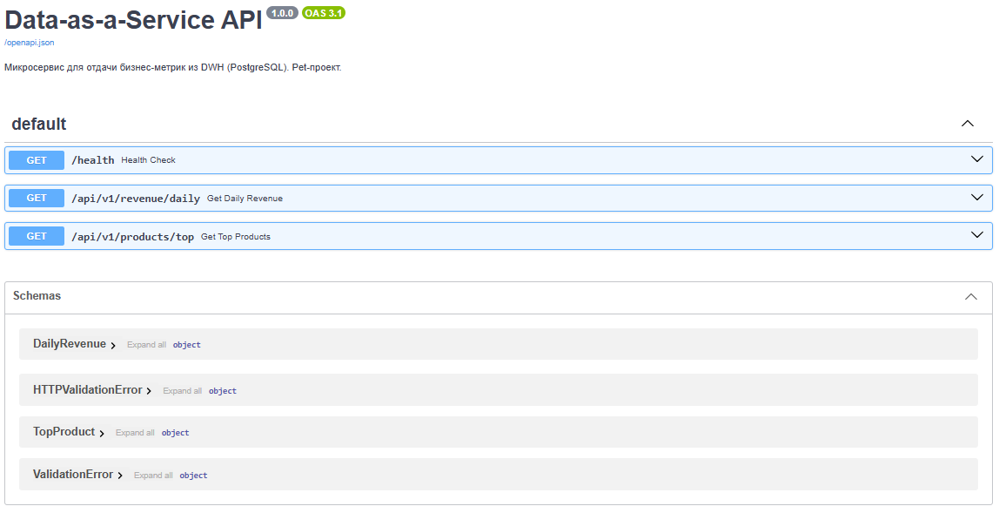
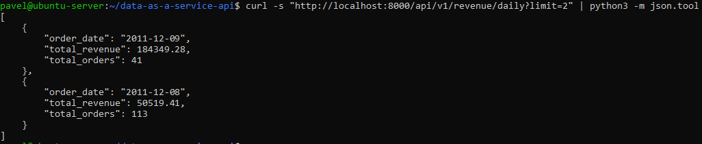
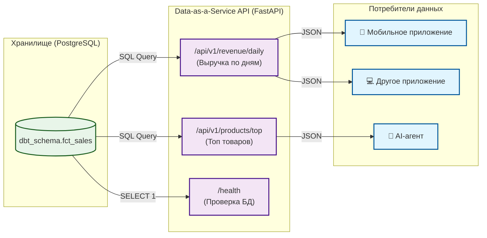

# 🚀 Data-as-a-Service API

Pet-проект: микросервис на **FastAPI** для отдачи бизнес-метрик из DWH (PostgreSQL) в формате JSON. Демонстрирует паттерн **Data-as-a-Service (DaaS)** — когда данные предоставляются как продукт для других приложений, а не только для BI-дашбордов.

## 📸 Скриншоты

**Swagger UI (документация API):**



**Ответ API (выручка по дням):**



## 🎯 Зачем это

В современной архитектуре данные — это продукт. BI-дашборды нужны аналитикам, но что если данные нужны мобильному приложению, другому микросервису или AI-агенту? Они не умеют смотреть в дашборды, им нужен программный интерфейс.

Этот проект показывает, как «обернуть» витрину данных в REST API, чтобы её могли потреблять любые системы.

## 🏗 Архитектура



**Стек:** Python 3.11, FastAPI, Uvicorn, psycopg2, PostgreSQL, Docker, Docker Compose.

## 📂 Структура

```
data-as-a-service-api/
├── app/
│   ├── __init__.py
│   ├── database.py       # Подключение к PostgreSQL
│   ├── main.py           # FastAPI приложение и эндпоинты
│   └── schemas.py        # Pydantic-модели для валидации ответов
├── Dockerfile            # Сборка Docker-образа
├── docker-compose.yml    # Запуск контейнера
├── requirements.txt
├── assets/               # Скриншоты для README
└── README.md
```

## 🚀 Запуск

### 1. Локальный запуск (без Docker)

```bash
pip install -r requirements.txt
uvicorn app.main:app --reload
```

API будет доступно по адресу `http://127.0.0.1:8000/docs` (Swagger UI).

### 2. Запуск в Docker

```bash
# Сборка и запуск контейнера
sudo docker compose up -d --build

# Проверка работы (изнутри VM/контейнера)
curl http://localhost:8000/health
# Ожидаемый ответ: {"status":"ok","database":"connected"}

# Проверка данных
curl "http://localhost:8000/api/v1/revenue/daily?limit=2"
```

> **Важно:** Если запускаешь в Docker внутри VirtualBox, в `docker-compose.yml` укажи `DB_HOST=10.0.2.2` (IP хоста Windows), так как `localhost` внутри контейнера — это сам контейнер.

## 🔌 Эндпоинты API

| Метод | Путь | Описание |
| :--- | :--- | :--- |
| `GET` | `/health` | Проверка живости сервиса и подключения к БД. |
| `GET` | `/api/v1/revenue/daily?limit=10` | Выручка и количество заказов по дням (последние N дней). |
| `GET` | `/api/v1/products/top?limit=10` | Топ-N товаров по выручке. |

## 📊 Результат

- API успешно подключается к PostgreSQL (DWH) и отдаёт данные из витрины `fct_sales`.
- Swagger UI автоматически генерирует документацию с описанием полей.
- Docker-контейнер работает изолированно и общается с БД на хост-машине через `10.0.2.2`.
- Готово к использованию в любых приложениях, которым нужны данные.

## 🔗 Связанные проекты

- [`marketplace-dwh-analytics`](https://github.com/nconichtchenko-arch/marketplace-dwh-analytics) — источник данных (витрина `fct_sales`).
- [`data-governance-platform`](https://github.com/nconichtchenko-arch/data-governance-platform) — управление данными и контракты.
- [`api-data-contracts`](https://github.com/nconichtchenko-arch/api-data-contracts) — валидация внешних API.

## 📫 Контакты

- **GitHub:** [github.com/nconichtchenko-arch](https://github.com/nconichtchenko-arch)
- **Email:** pavloni@mail.ru
- **Формат работы:** удалённо
